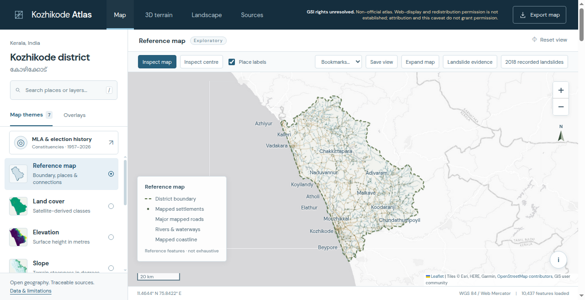
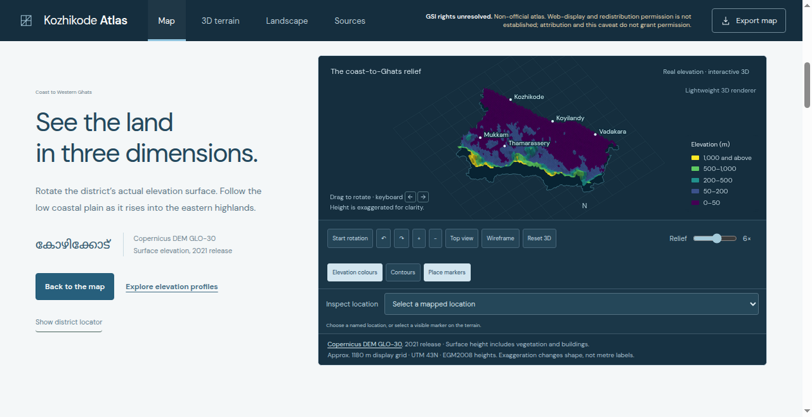
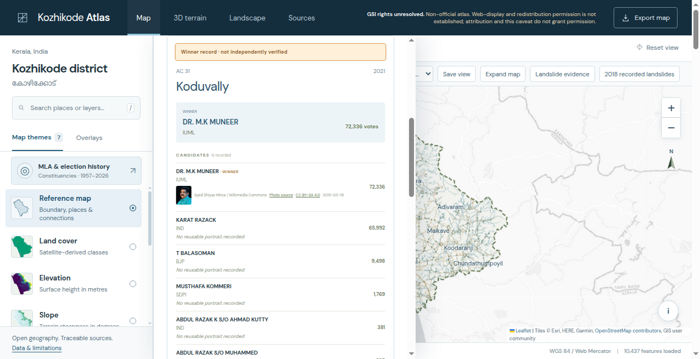

# Kozhikode Atlas

A map of Kozhikode district, from the Malabar coast to the Western Ghats. It brings reference geography, land cover, terrain and a matched-season satellite comparison into one small static site.

The map comes first. The interface uses quiet colours, compact source notes and a few ways to explore the same landscape: a flat map, a 3D terrain view, an elevation profile and a guided geography story. There is no account system, application server or runtime API key.

## Run it locally

You only need Python to serve the site:

```sh
python3 -m http.server 8000 --directory site
```

Open <http://localhost:8000>. Opening the HTML file directly will not work reliably because the app fetches its data over HTTP. Context tiles need an internet connection; the bundled data does not.

## What is in the map?

- District geography and mapped places, roads, rivers and coastline from geoBoundaries and OpenStreetMap.
- Surface elevation, slope and land cover from Copernicus DEM and ESA WorldCover.
- January–March 2019 and 2025 Sentinel-2 imagery, with exploratory Dynamic World built-up signals and clear-observation summaries.
- Indicative assembly constituency borders and an election archive. Older seats stay separate from today's polygons.
- GSI 2022 landslide susceptibility zones, with an explicit unresolved-rights notice and a source-class inspector.
- A separate overlay of 235 recorded landslide initiation points from the 2018 monsoon inventory.

**GSI reuse rights remain unresolved.** The app displays GSI 2022 susceptibility zones supplied through KSDMA. Permission for web display and redistribution of this district derivative has not been established. Attribution and this caveat do not grant permission. This is a non-official atlas, not a GSI or KSDMA product or warning service. See [the full GSI rights and source notice](site/data/GSI_RIGHTS.md). GSI map exports remain blocked; other atlas exports remain available.

The 2018 points are a different, licensed dataset: C.J. van Westen (2020), *Landslide inventory of the 2018 monsoon rainfall in Kerala, India*, version 2.0, [DANS](https://doi.org/10.17026/dans-x6c-y7x2), [CC BY 4.0](https://creativecommons.org/licenses/by/4.0/). The atlas selects points within its district boundary, keeps a reduced set of fields and converts the result to 2D WGS 84 GeoJSON. These are historical initiation points, not landslide footprints, current warnings or evidence that nearby land is safe. Source district labels and the atlas boundary do not always agree; the selection checks are retained in the provenance file.

## Read the sources before drawing conclusions

This is an exploratory atlas, not an official boundary record, navigation tool or site-safety assessment. The DEM is a surface model that includes vegetation and buildings. The inspector reads a roughly 100 m display grid, not native-resolution measurements. Missing data is not zero.

The urban comparison shows candidate model signals, not confirmed new buildings or a validated urban-area estimate. Soil, seasonal land management, haze, mixed pixels and classification errors can look like change. No independent ground-reference accuracy or sub-pixel registration RMSE is claimed. See [the urban comparison notes](docs/URBAN_COMPARISON.md).

Election results come from a secondary compilation. Current winner checks do not mean every candidate row has been reconciled with official returns. Historical coverage is incomplete, and constituency borders are indicative rather than legal. Portraits are bundled only where the existing source record identifies a reusable image and its credit; rights-retained official profile image URLs are omitted.

Layer dates, licences, methods and caveats live beside the data:

- [`inventory.json`](site/data/inventory.json): reference geography.
- [`thematic.json`](site/data/thematic.json): raster layers and legends.
- [`urban-provenance.json`](site/data/urban-provenance.json): satellite processing and output checksums.
- [`landslide-inventory-provenance.json`](site/data/landslide-inventory-provenance.json): historical point selection and attribution.
- [`elections.json`](site/data/elections.json) and [`portraits.json`](site/data/portraits.json): election sources and image credits.

[Data credits and third-party licences](docs/DATA_CREDITS.md) explain what can be reused. The MIT licence covers the project code, not every dataset or image.

## Screenshots

These are direct captures of the running app, not mockups. The rights notice and source labels remain visible.

### Reference map



District geography and mapped connections, with the legend and basemap credits in view.

### Coast-to-Ghats terrain



The terrain can be rotated; this view is not north-up. Relief is exaggerated six times for clarity. The source is a surface model, not a bare-earth survey.

### Election archive



The 2021 Koduvally record is shown with its secondary-source warning. Dr. M. K. Muneer's photograph is by [Syed Shiyaz Mirza / Wikimedia Commons](https://commons.wikimedia.org/wiki/File:MK_Muneer.jpg), [CC BY-SA 4.0](https://creativecommons.org/licenses/by-sa/4.0/), displayed at thumbnail size by the app. It is a real photograph, not generated candidate imagery.

[Screenshot sources and reuse notes](docs/screenshots/README.md) cover the basemap, terrain and portrait rights; project MIT does not override them.

## Work on the code

`site/` is the complete static frontend. It uses plain HTML, CSS and JavaScript, with local copies of Leaflet, Three.js and fonts. `scripts/` contains the retained preparation code. `tests/` checks the bundled data and frontend contracts.

For the Python checks, use Python 3.12 and Node.js for JavaScript syntax checks:

```sh
python3 -m venv /tmp/kozhikode-atlas-venv
. /tmp/kozhikode-atlas-venv/bin/activate
python -m pip install -r requirements.txt
PYTHONDONTWRITEBYTECODE=1 python -m unittest discover -s tests -v
```

Tests use the files in this repository, not a private workspace. Checks that need omitted raw rasters report a skip. Static contracts and syntax checks do not replace a browser test of interactions, rendering or downloads.

Preparation scripts download or produce local `raw/` and `work/` directories. Those inputs are deliberately absent from this public snapshot. `acquire.py` and `thematic.py` prepare the base layers; `prepare_inspector.py` and `prepare_terrain_3d.py` build their query and terrain assets. `prepare_landslides.py` prepares the GSI display/query rasters; `annotate_landslide_research.py` adds public-source evidence, scale and coverage notes without changing class pixels. `prepare_landslide_inventory.py` retrieves and checksum-checks the licensed DANS inventory; any GSI overlap counts are descriptive, not independent validation. These scripts do not establish reuse permission. The urban workflow needs your own authorised Earth Engine project. It is documented separately; credentials are never part of the site.

These are individual preparation steps, not a one-command rebuild of every election, portrait and locator asset. A new source download can change the snapshot. Review the resulting metadata, licences and tests before replacing published data.

Keep changes small. Preserve source caveats, metadata-driven legends, keyboard controls and reduced-motion behaviour. Do not make the imagery look more precise than the source permits.

## Hosting and reuse

Serve only `site/` on a static host. GitHub Pages can serve that directory through a separate deployment setup; the included workflow runs tests only and does not deploy.

Hosting the app or publishing its source does not establish permission to reuse the GSI data. Check the [data credits](docs/DATA_CREDITS.md) and retain each source's notices. The project MIT licence does not override data rights.

There is intentionally no `.gitignore`. If you generate raw downloads, caches or local credentials while working, inspect the exact file list before staging changes. Never add the whole working directory without reviewing it.

## Licence

Project source code: [MIT](LICENSE). Data, photographs, fonts and bundled libraries keep their own terms. Keep their notices and attribution with any redistribution.
